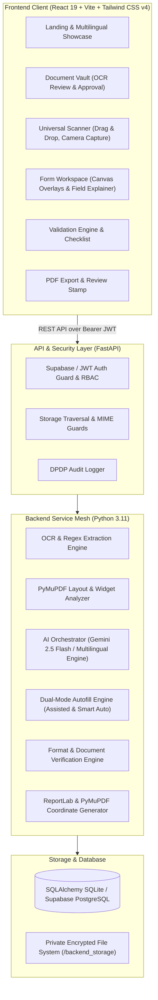

# FormWise AI — System Architecture & Technical Specifications

> **Tagline:** Understand. Fill. Verify. Apply.  
> **Market Target:** India (Scholarships, Admissions, Government Certificates & Schemes)  
> **Compliance:** Digital Personal Data Protection (DPDP) Act 2023  

---

## 1. High-Level Architecture

FormWise AI is engineered as an India-first, decoupled, resilient full-stack web platform built for high-throughput document intelligence, multi-modal OCR extraction, bilingual assistance (English, Telugu, Hindi), and pixel-accurate form generation.

---

## 2. Component Design & Service Breakdown

### 2.1 Frontend Architecture (`frontend/`)
- **Framework:** React 19 with Vite bundler.
- **Styling:** Tailwind CSS v4 (`@tailwindcss/vite`) utilizing modern CSS variables and a custom design system tokenized around:
  - Deep Navy (`#0B132B`, `#1C2541`)
  - Electric Violet (`#7928CA`, `#6366F1`)
  - Soft Cyan & Accent (`#00F2FE`, `#38BDF8`)
- **State & Context:**
  - `AuthContext`: Manages JWT storage in `localStorage`, token refresh, user profile caching, and automatic logout upon 401.
  - `LanguageContext`: Internationalization engine providing live toggle between English, Telugu (తెలుగు), and Hindi (हिन्दी).
- **Core Views:**
  - `LandingPage`: Product features, interactive dual-mode simulator, DPDP security manifesto, FAQ.
  - `VaultPage`: Document category tabs, real-time OCR extraction preview, and citizen verification modal.
  - `FormUploadPage`: HTML5 drag-and-drop file browser with native WebRTC camera scanner (with perspective cropping & rotation options).
  - `FormWorkspacePage`: Dual-pane interface with page navigation, rendered PNG preview, interactive SVG bounding-box highlights, field explainer card, conversational AI chat, and autofill drawer.
  - `ValidationPage`: Real-time format integrity checks (Aadhaar, PAN, PIN, Mobile, IFSC, Income) and missing certificate warnings.
  - `HistoryPage`: Downloadable completed applications and user-accessible audit logs.

### 2.2 Backend Architecture (`backend/app/`)
- **FastAPI Core (`backend/app/main.py`)**: High-performance asynchronous API server with CORS middlewares, automatic OpenAPI specification generation (`/docs`), and dependency injection.
- **Security & Cryptography (`backend/app/core/security.py`)**:
  - Direct `bcrypt` password hashing (strictly truncating at 72 bytes to avoid passlib overflows).
  - HS256 JWT tokens with role-based claim checking.
  - DPDP Data Minimization: identity numbers (Aadhaar, Account numbers) stored and transmitted with masking (`XXXX-XXXX-1234`).
- **Database Engine (`backend/app/database/session.py`)**:
  - SQLAlchemy ORM with foreign key cascades.
  - Standard rollback journal configuration with SQLite `timeout=30` (resilient to Windows filesystem locks).
  - Plug-and-play compatibility with Supabase PostgreSQL via `DATABASE_URL`.
- **Storage Subsystem (`backend/app/core/storage.py`)**:
  - Isolated citizen storage buckets:
    - `vault/<user_id>/`
    - `forms/<user_id>/`
    - `forms/previews/<form_id>/`
    - `exports/<user_id>/`
  - MIME type whitelisting (`application/pdf`, `image/png`, `image/jpeg`).
  - Path-traversal sanitization (`os.path.basename` enforcement).

---

## 3. Intelligent AI & Pipeline Workflows

### 3.1 OCR & Entity Extraction (`ocr_service.py`)
- Extracts text via PyMuPDF text streams and regular expression heuristics specifically calibrated for Indian government and institutional documents:
  - Masked Aadhaar: `XXXX XXXX 1234` or `\d{4}\s\d{4}\s\d{4}` (masked immediately before persistence).
  - PAN: `[A-Z]{5}[0-9]{4}[A-Z]{1}`.
  - Date of Birth: `DD/MM/YYYY`, `DD-MM-YYYY`, `YYYY-MM-DD`.
  - Annual Family Income: Recognizes "Rs.", "₹", "Rupees", "per annum", "p.a.", "gross annual income".
  - Community/Caste: OBC, SC, ST, EWS, BC-A/B/C/D/E, General.
  - IFSC Code: `^[A-Z]{4}0[A-Z0-9]{6}$`.
- **Citizen Consent Workflow:** Extracted entities are saved with `is_approved=False`. They are **never** populated into forms until the user explicitly reviews and confirms each value.

### 3.2 Form Layout Analysis (`form_analyzer.py`)
- Analyzes multi-page PDFs or uploaded images.
- Renders high-resolution page previews (150 DPI) to PNG files for browser viewport overlay.
- Extracts form labels, blank underline zones (`_____`), interactive PDF form fields (`AcroForm`), and computes normalized bounding box coordinates (`bbox_x`, `bbox_y`, `bbox_width`, `bbox_height`).

### 3.3 Multilingual Field Explanation & Chat (`ai_orchestrator.py`)
- Integrates Google Gemini (`gemini-2.5-flash` via `google-genai` SDK) when `LLM_API_KEY` is provided.
- Embeds a deterministic, zero-latency offline bilingual fallback engine covering standard Indian administrative fields with cultural accuracy:
  - English, Telugu (`తెలుగు`), and Hindi (`हिन्दी`).
  - Practical explanations, realistic examples, required certificates, and common rejection pitfalls.

### 3.4 Dual-Mode Autofill Engine (`autofill_engine.py`)
- **Mode A (Assisted Autofill):** Generates ranked suggestions with confidence scores and source document citations. The citizen clicks to accept each field individually.
- **Mode B (Smart Automatic Autofill):** Automatically accepts non-sensitive fields when confidence $\ge 95\%$. Highly sensitive fields (Aadhaar, Caste, Bank Account) are highlighted in yellow and require mandatory one-click confirmation.

### 3.5 Validation Engine (`validation_engine.py`)
- Formats:
  - Indian Mobile: 10 digits starting with 6, 7, 8, or 9.
  - PIN Code: 6 digits starting with 1 to 9.
  - PAN: 5 uppercase letters, 4 digits, 1 uppercase letter.
  - IFSC: 4 uppercase letters, digit 0, 6 alphanumeric characters.
- Cross-Field Logic: Checks if caste quota or income-based fee concession was claimed without corresponding approved certificates in the Vault.

### 3.6 PDF Generator (`pdf_generator.py`)
- Renders completed text directly onto original coordinates using PyMuPDF.
- Populates native interactive form fields (AcroForm widgets).
- Adds a tamper-evident FormWise review footer stamp:  
  `[Verified & Prepared via FormWise AI - DPDP Compliant]`

